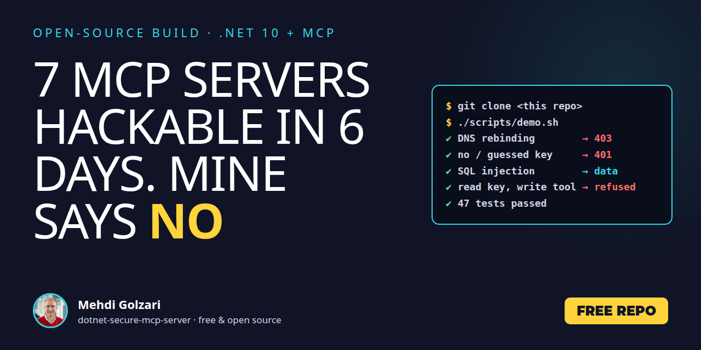
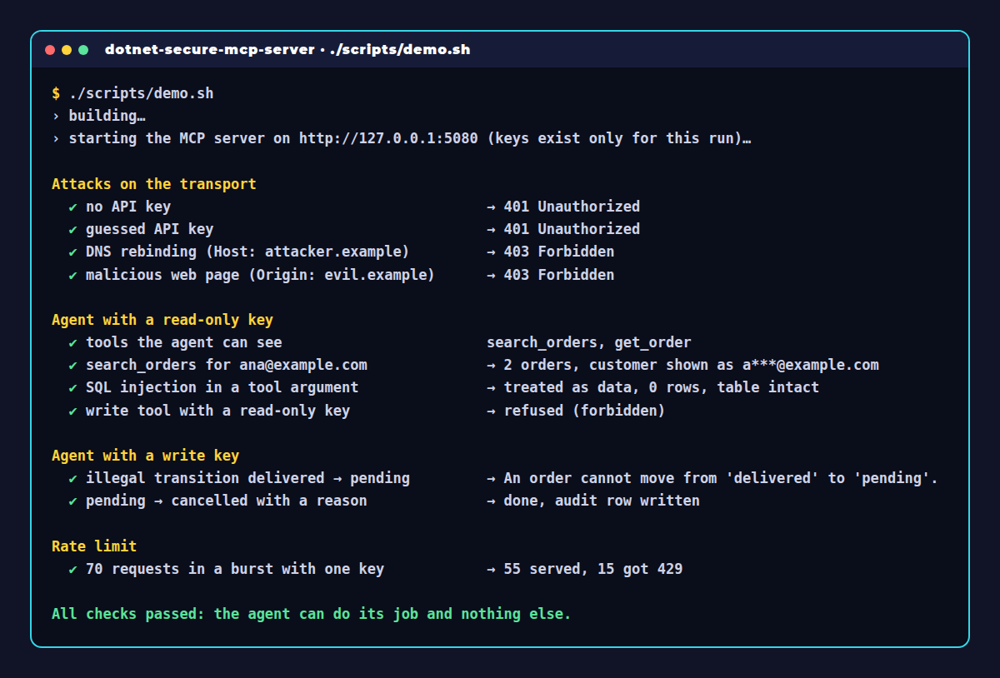
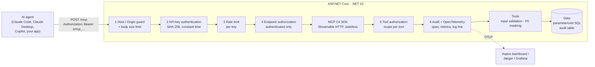

<div align="center">



# dotnet-secure-mcp-server

**A production-ready MCP server template for .NET 10.**<br>
Built on the official MCP C# SDK, with the security checks that this week's MCP CVEs were missing: Host/Origin validation, scoped API keys, parameterized SQL, per-tool authorization, rate limits, audit logs and OpenTelemetry.

[](https://github.com/mgmehdiforme/dotnet-secure-mcp-server/actions/workflows/ci.yml)
[](LICENSE)
[](https://dotnet.microsoft.com/)
[](https://www.nuget.org/packages/ModelContextProtocol.AspNetCore)
[](#-contributing)

[Quick start](#-quick-start) · [What it blocks](#-what-it-blocks) · [Architecture](#-architecture) · [Production-ready](#-what-makes-it-production-ready) · [Use it](#-use-it-for-your-own-tools) · [FAQ](#-faq)

</div>

---

## 🔥 Why this exists

An MCP server is an API that an AI agent calls with your credentials. Most MCP servers are written like demos.

Between **November 19 and 24, 2026** (UTC), GitHub published security advisories for **seven MCP servers**. Three were rated critical. They fall into three classes:

| Class | Advisories (GitHub Advisory Database) |
|---|---|
| **DNS rebinding**: any website you visit can drive the local server | [todoist-mcp CVE-2026-76807](https://github.com/advisories/GHSA-833v-v58w-294h) (critical) · [obsidian-sync-mcp CVE-2026-77283](https://github.com/advisories/GHSA-mx6p-3fg7-v6pj) · [jupyter-mcp-server CVE-2026-77359](https://github.com/advisories/GHSA-9x8x-crjq-g64h) (critical) |
| **No authentication on the network transport** | [k8s-mcp-server CVE-2026-130007](https://github.com/advisories/GHSA-m932-63jc-4jqq) · [ruflo CVE-2026-59726](https://github.com/advisories/GHSA-c4hm-4h84-2cf3) (critical, remote code execution) |
| **SQL injection through tool arguments** | [sqlite-mcp CVE-2026-130008](https://github.com/advisories/GHSA-q433-mp6c-8v4f) · [mssql-mcp-core CVE-2026-63129](https://github.com/advisories/GHSA-2m9m-6cr5-9x25) |

None of these needs a clever exploit. Each is a missing or incomplete check that a normal production web API has. This template has all of them, with a test for each, so you can start from a server that says **no** and add your own tools.

## ⚡ Quick start

You need the [.NET 10 SDK](https://dotnet.microsoft.com/download). No API key, no cloud account.

```bash
git clone https://github.com/mgmehdiforme/dotnet-secure-mcp-server
cd dotnet-secure-mcp-server
./scripts/demo.sh
```

`demo.sh` builds the server, creates two throwaway keys (read-only and read-write), starts the server on `127.0.0.1:5080` with a temporary database, and attacks it with the official MCP C# client:



## 🛡 What it blocks

| Attack | What happens | Where |
|---|---|---|
| A web page rebinds its domain to `127.0.0.1` and calls your local server | **403** `host_not_allowed`. The request still carries the attacker's `Host`, which is not on the allow-list | `HostOriginGuardMiddleware` |
| A web page calls the server from the browser | **403** `origin_not_allowed`. Only origins you list are accepted; CLI and desktop clients send no `Origin` and pass | `HostOriginGuardMiddleware` |
| No key, a guessed key, a `Basic` header | **401** with `WWW-Authenticate: Bearer` | `ApiKeyAuthenticationHandler` |
| A read-only agent calls a write tool (say, after a prompt injection) | Refused and audited. It doesn't even see the tool in `tools/list` | `[Authorize(Policy = "orders.write")]` + `AddAuthorizationFilters()` + `AuditingAuthorizationService` |
| `x'; DROP TABLE orders; --` in a tool argument | Bound as a value: 0 rows, table intact | `OrderRepository` (parameters only) |
| An agent stuck in a loop, or a leaked key used for scraping | **429** with `Retry-After`, per key, so one client can't starve the others; each refusal is logged with the client id | ASP.NET Core rate limiter |
| A 10 MB request body | **413** before parsing | `HostOriginGuardMiddleware` |
| An agent "reopens" a delivered order, or changes one without a reason | Tool error with a clear message; only forward transitions, reason required | `OrderStatus.CanMove`, tool validation |
| A tool crashes with a stack trace | The client gets a generic error; details stay in your logs | MCP SDK + `McpException` for expected errors |

## 🧭 Architecture



Every request passes the layers in this order. The cheapest checks run first, so a rebinding or cross-site request never touches authentication, and an unauthenticated request never touches the MCP layer.

```
src/SecureMcp.Server/
├── Program.cs                         the pipeline, in order
├── KeyCommand.cs                      `new-key`: prints a key once, stores only its hash
├── Security/
│   ├── HostOriginGuardMiddleware.cs   DNS rebinding, cross-site and body-size checks
│   ├── AuditingAuthorizationService.cs audits every refused tool call
│   ├── ApiKeyAuthenticationHandler.cs bearer keys -> claims + scopes
│   ├── ApiKeys.cs                     key generation, hashing, constant-time lookup
│   └── McpSecurityOptions.cs          validated at startup (fail fast)
├── Tools/OrderTools.cs                3 example tools with scopes, validation, masking
├── Data/OrderRepository.cs            SQLite, parameterized, audited transitions
└── Observability/Telemetry.cs         tool-call filter: trace, metrics, audit log
samples/SecureMcp.Demo/                the attack demo (official MCP client)
tests/SecureMcp.Tests/                 47 tests, in-memory server, real MCP calls
```

## ✅ What makes it production-ready

- **Security by default.** Binds to `127.0.0.1`. Host and Origin allow-lists. The server **refuses to start** with no keys, malformed hashes or ids, unknown scopes, or duplicate ids or hashes, and prints every problem.
- **Keys are stored as hashes.** `dotnet run --project src/SecureMcp.Server -- new-key <client> <scopes...>` prints the key once. Only its SHA-256 goes into configuration. A leaked `appsettings.json` or `.env` contains no usable key. Remove a hash and the key stops working as soon as configuration reloads (`appsettings.json` reloads on change; environment variables need a restart).
- **Least privilege per tool.** Scopes (`orders.read`, `orders.write`) are ASP.NET Core policies. A tool declares the one it needs with `[Authorize]`, and tools a key can't use are hidden from it.
- **Tools are written like public APIs.** Allow-listed enums, length limits, a hard `limit` cap of 50, forward-only state transitions, a mandatory reason for writes, and customer emails masked (`a***@example.com`) because the model rarely needs them.
- **Every write is audited** in the same database transaction, with the key id as the actor.
- **Observability.** Every tool call, including refused ones, writes one audit log line (client, tool, outcome) and counts in `mcp.tool.calls` by tool and outcome (`ok`, `rejected`, `failed`, `forbidden`). Executed calls also get a trace span and an `mcp.tool.duration` histogram, and rate-limited requests are logged with the client id. Tool names from the client are checked against the registered tools before they reach logs or metric tags, and arguments are never logged. Set `OTEL_EXPORTER_OTLP_ENDPOINT` to ship them to the Aspire dashboard, Jaeger or Grafana.
- **Stateless Streamable HTTP**, as the 2026-07-28 MCP revision requires (it removed protocol sessions), so instances need no session affinity. To scale out, point them at a shared database and note that rate limits are counted per instance (use a distributed limiter or your gateway's limits if you need a global one).
- **Container hardening.** Non-root user, read-only root filesystem, `no-new-privileges`, port published on loopback only (`docker-compose.yml`).
- **Tested.** 47 xUnit tests run the real server in memory and call it with the official MCP C# client, plus CI runs the attack demo end to end and checks that the Docker image refuses to start without keys. Warnings are errors.

## 🔌 Use it for your own tools

1. Replace `Tools/OrderTools.cs` and `Data/OrderRepository.cs` with your domain. Keep the patterns: `[Authorize(Policy = ...)]` on every tool, validate every argument, throw `McpException` for errors the model should see, use parameters for every query.
2. Add your scopes to `Security/Scopes.cs` and register a policy for each in `Program.cs`.
3. Create a key per client and add its hash:

```bash
dotnet run --project src/SecureMcp.Server -- new-key claude-code orders.read
```

**Connect Claude Code** (server running with that key's hash configured):

```bash
claude mcp add --transport http orders http://127.0.0.1:5080/mcp --header "Authorization: Bearer <your key>"
```

**Run it in Docker:** copy `.env.example` to `.env`, fill in the hash, then `docker compose up --build`.

| Setting (`appsettings.json` or env var) | Default |
|---|---|
| `McpSecurity:AllowedHosts` | `localhost`, `127.0.0.1`, `[::1]` |
| `McpSecurity:AllowedOrigins` | none (no browser access) |
| `McpSecurity:ApiKeys` | none: the server will not start without one |
| `McpSecurity:RequestsPerMinute` | `60` per key |
| `McpSecurity:MaxRequestBodyBytes` | `65536` |
| `ConnectionStrings:Orders` | `Data Source=orders.db` |
| `OTEL_EXPORTER_OTLP_ENDPOINT` | unset (no export) |

## ❓ FAQ

**Why API keys and not OAuth?** For a server your own agents and teammates use, scoped keys stored as hashes are simple and strong. For a public, multi-tenant server, the MCP spec's OAuth 2.1 authorization is the right next step: the SDK supports it and the rest of this pipeline (Host/Origin guard, scopes as policies, per-tool `[Authorize]`, rate limits, audit) stays the same.

**Does the Host check break my deployment?** Add the host names your clients use (for example `mcp.mycompany.com`) to `McpSecurity:AllowedHosts`. That is the point: the server should answer only to names you chose.

**Can an agent learn customer emails through search?** Results are masked, but a search by a full email that returns orders confirms that the address is a customer. If that matters for you, put email search behind its own scope or remove it.

**Is SQLite required?** No. It keeps the demo dependency-free. Swap `OrderRepository` for EF Core, Dapper or an HTTP API. The rule stays: values from the model are parameters, never SQL text.

**Does this stop prompt injection?** Not by itself, and nothing does fully. It limits the damage: an injected agent can only call the tools its key allows, with validated arguments, at a limited rate, and every write is audited with the key that made it.

**Can I use it with stdio instead of HTTP?** Not as is. The scopes come from the HTTP API key, so over stdio there is no caller identity and the `[Authorize]` checks don't apply the same way. The tool validation, parameterized SQL and audit patterns carry over; for stdio, give each process only the tools and data access it needs. This week's CVEs were all on network transports.

## 🤝 Contributing

Issues and PRs are welcome. Run `dotnet test --solution SecureMcp.slnx` and `./scripts/demo.sh` before opening a PR. Every new protection needs a test that attacks it.

## 📺 Video

Video walkthrough: <YOUTUBE_URL>

---

Built by **[Mehdi Golzari](https://www.linkedin.com/in/mehdigolzariofficial/)**. I take AI-built apps from prototype to production.
Need a custom MCP server for your tools and data, built like this? [Here's how I can help](https://www.fiverr.com/mehdigolzari/build-a-custom-mcp-server-to-connect-claude-or-chatgpt-to-your-tools-and-data).

⭐ **If this saved you from shipping an open MCP server, star the repo** so other builders find it.
